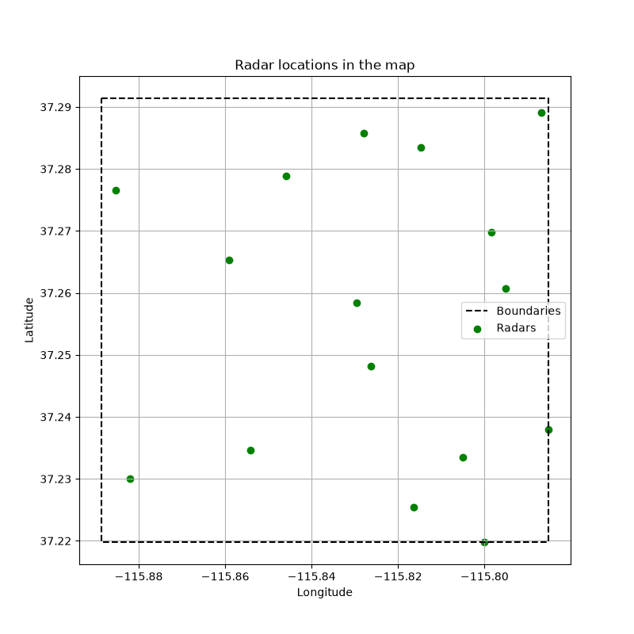
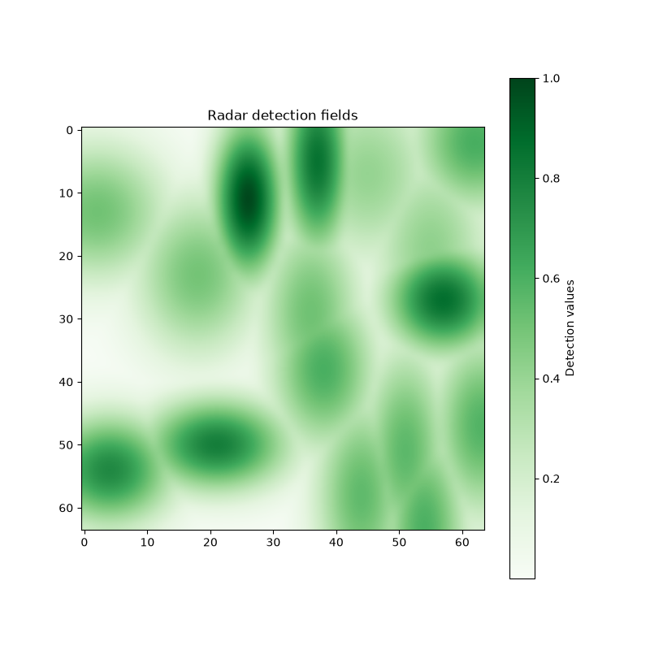
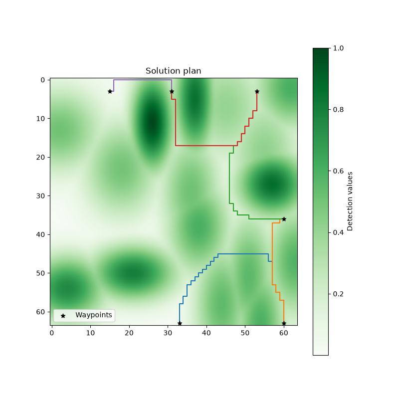
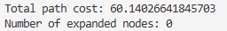

Proyecto en Python que modela un mapa geográfico con radares y calcula rutas entre distintos puntos de interés (POI), evitando las zonas cuya probabilidad de detección supera una tolerancia determinada.

## Características
- Generación aleatoria de radares.
- Cálculo del mapa de detección.
- Construcción de un grafo de navegación.
- Búsqueda de rutas mediante A*.
- Ordenación de los POI mediante un plan de alto nivel.
- Visualización de radares, zonas de detección y rutas calculadas.

## Requisitos
- Python 3
- NumPy
- Matplotlib
- NetworkX
- tqdm

## Ejecución
`main.py scenario_5 0.5`
El primer argumento indica el escenario definido en scenarios.json. El segundo argumento es la tolerancia máxima de detección permitida.

## Salida
El programa muestra:
1. La ubicación de los radares.

2. El mapa de detección.

3. La ruta calculada entre los puntos de interés.

4. El coste total de la ruta y el número de nodos explorados.

